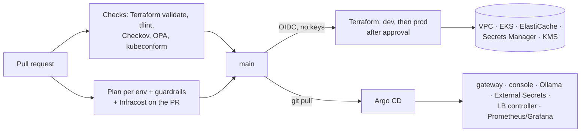

# llm-gateway-platform

[](https://github.com/sillykea/llm-gateway-platform/actions/workflows/ci.yml)

Production AWS platform for [llm-gateway](https://github.com/sillykea/llm-gateway) and its [console](https://github.com/sillykea/llm-gateway-console): a multi-AZ EKS cluster, managed Redis and secrets, all built with Terraform, delivered with Argo CD, and guarded by policy as code, without a single long-lived credential.

The gateway repo shows how the service is built. This repo shows how it's run.



## What's in it

**Infrastructure as code (Terraform)**
- VPC across three AZs with three subnet tiers (public, private, isolated), VPC flow logs, a locked-down default security group, and an S3 gateway endpoint that keeps traffic off NAT
- EKS with managed nodes on AL2023, private API endpoint by default, KMS envelope encryption for Secrets, access entries instead of `aws-auth`, IMDSv2 enforced, and prefix delegation for pod density
- ElastiCache Redis in isolated subnets, reachable only from the nodes, with TLS and an auth token generated by Terraform and delivered through Secrets Manager
- Secrets Manager with a dedicated KMS key. Terraform creates the secret but never sees its value.
- EKS Pod Identity: one IAM role per component, scoped to one service account
- Reusable stacks configured per environment, with separate state per stack, and S3 native state locking

**Delivery (GitOps)**
- Terraform installs only Argo CD. An app-of-apps then installs everything else in sync waves: External Secrets, AWS Load Balancer Controller, kube-prometheus-stack and the gateway
- Infrastructure facts (VPC ID, Redis address, secret name) flow from Terraform outputs into Argo CD as Helm values, never copied by hand

**Pipelines (GitHub Actions)**
- Every PR: `terraform fmt`/`validate`, tflint, Checkov on Terraform *and* rendered manifests, kubeconform against Kubernetes and CRD schemas, and OPA policy unit tests
- PRs touching Terraform: a plan for each environment, OPA guardrails evaluated on the real plan, and an Infracost estimate, all posted as a PR comment
- Merges: apply to dev, then prod after a reviewer approves. AWS access is through OIDC only.

**Security**
- Account baseline: CloudTrail with log validation, AWS Config, GuardDuty with EKS audit-log and runtime monitoring, and Security Hub with the CIS AWS Foundations benchmark
- Default-deny NetworkPolicies, and non-root, read-only, capability-free containers
- [Controls mapped to threats](docs/security.md), with the known gaps stated

**The gateway chart**
- Zero-downtime rollouts (`maxUnavailable: 0`, readiness gates, `preStop` drain, PDB), zone and node spreading, HPA with scale-down damping, config-change rollouts, ServiceMonitor and PrometheusRule with runbook links
- Refuses to render without an immutable image tag

**The console chart**
- Deploys [llm-gateway-console](https://github.com/sillykea/llm-gateway-console) as a single-writer StatefulSet; gateways pull keys from it every 30 seconds and keep the last good set if it's down
- Sync token and session secret generated by Terraform; sign-ins written by hand so password hashes never reach state
- The key-sync port accepts only gateway pods, enforced by NetworkPolicy on both sides, and is never exposed through the ingress

## Repository layout

```
terraform/
  bootstrap/          state bucket, KMS, GitHub OIDC provider and CI roles
  modules/            network · cluster · cache · secrets · security-baseline
  stacks/             account · infra · platform   (written once)
  envs/{dev,prod}/    tfvars and backend config     (what differs)
charts/llm-gateway/   gateway Helm chart, values per environment
charts/llm-gateway-console/   console Helm chart
gitops/apps/          Argo CD app-of-apps
policy/terraform/     OPA guardrails + unit tests
local/                run the chart on kind, no AWS needed
docs/                 architecture, ADRs, runbook, security, cost
```

## Try it

**Locally, free** (Docker, kind, kubectl, helm):

```bash
GATEWAY_TAG=b477f3e0534211c352ff988cadd8990b8e04f289 make local-up
kubectl -n llm-gateway port-forward svc/llm-gateway 8080:80
curl localhost:8080/v1/models -H "Authorization: Bearer dev-key"
```

**On AWS:** follow [first-time setup](docs/runbook.md#first-time-setup). Dev costs
roughly $0.30/hour while it's up ([cost breakdown](docs/cost.md)); `make destroy ENV=dev`
stops the meter.

## Design decisions

1. [Community modules behind thin local wrappers](docs/adr/0001-community-terraform-modules.md)
2. [Terraform builds the cluster; Argo CD runs what's on it](docs/adr/0002-gitops-with-argocd.md)
3. [CI access: narrow trust, broad apply permissions](docs/adr/0003-ci-access-roles.md)
4. [Redis with TLS and an auth token](docs/adr/0004-redis-tls-and-auth.md)
5. [Dev optimises for cost, prod for resilience](docs/adr/0005-environment-sizing.md)
6. [Prevent, then detect](docs/adr/0006-layered-security.md)
7. [Deploying the console](docs/adr/0007-console-deployment.md)

## Roadmap

- Karpenter for faster, cheaper node provisioning
- ElastiCache IAM authentication instead of an auth token (ADR 0004)
- A scoped apply policy instead of AdministratorAccess (ADR 0003)
- Argo CD behind SSO with an internal ALB
- Console store on RDS Postgres, for more than one replica (ADR 0007)
- Multi-account setup (separate dev and prod accounts under AWS Organizations)

## License

MIT
