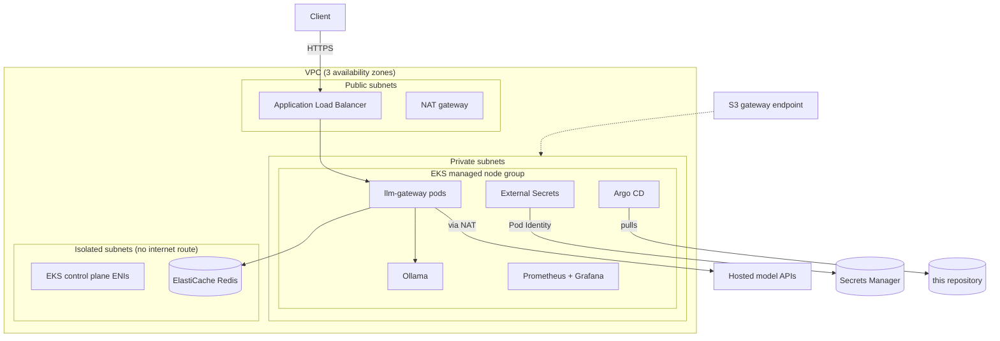
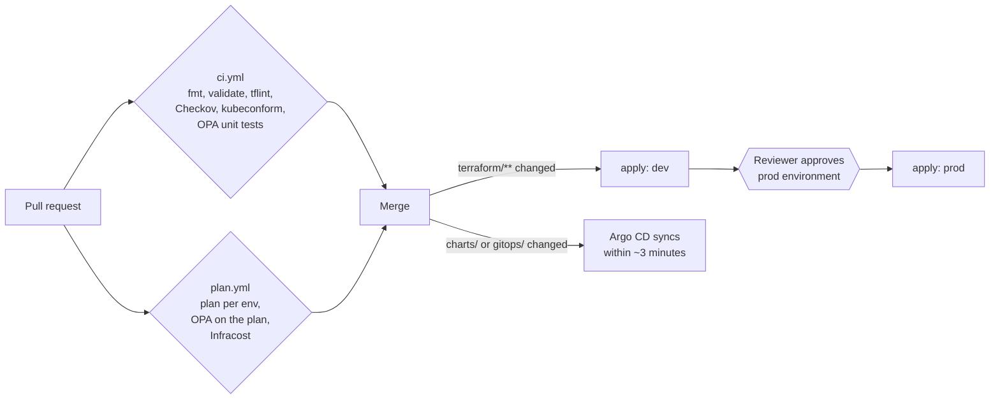

# Architecture

## AWS layout (one environment)



Each tier has one job. Load balancers and NAT gateways are the only things
in public subnets. Workloads run in private subnets and reach the internet
only through NAT. The cache and the control plane's network interfaces sit
in isolated subnets with no internet route at all.

## How a change reaches the cluster



There are two delivery paths, and the split is deliberate:

| What changed | Delivered by | Why |
|---|---|---|
| AWS resources (`terraform/`) | GitHub Actions → Terraform | Needs AWS credentials and a reviewed plan |
| What runs in the cluster (`charts/`, `gitops/`) | Argo CD pulling from git | No cluster credentials in CI; drift is reverted automatically |

## Terraform layout

```
terraform/
  bootstrap/        one-time: state bucket, KMS key, GitHub OIDC + CI roles
  modules/          reusable building blocks, no provider config
    network/        VPC, 3 subnet tiers, NAT, flow logs, S3 endpoint
    cluster/        EKS, managed nodes, add-ons, Pod Identity roles
    cache/          ElastiCache Redis, SG allowing the nodes only
    secrets/        Secrets Manager secret + KMS + reader role
    security-baseline/  CloudTrail, Config, GuardDuty, Security Hub
  stacks/           deployable roots, written once
    account/        security baseline, once per AWS account
    infra/          network + cluster + cache + secrets, per environment
    platform/       Argo CD + root app, per environment
  envs/<env>/       only what differs: *.tfvars and *.backend.hcl
```

Stacks are written once and configured per environment, so dev and prod
can't drift apart in structure, only in the values in `envs/`. Each stack
has its own state file, so a mistake in one can't corrupt another, and the
platform stack's Helm provider only ever talks to a cluster that already
exists (see ADR 0002).

## Boot order

1. `bootstrap`: state bucket and CI roles. Run once, locally, with admin credentials.
2. `account`: security baseline.
3. `infra` for an environment: about 15 minutes, mostly EKS.
4. Store the API keys and console sign-ins in Secrets Manager (`make secrets`,
   `make console-users`).
5. `platform`: installs Argo CD and the root Application. Argo CD then installs,
   in sync-wave order:
   - wave −3: gp3 StorageClass (monitoring's volume needs it)
   - wave −2: External Secrets Operator, AWS Load Balancer Controller, monitoring
   - wave −1: ClusterSecretStore (needs the External Secrets CRDs)
   - wave 0: the console (ExternalSecret → Secret → StatefulSet), so keys exist
     before any gateway asks for them
   - wave 1: the gateway (ExternalSecret → Secret → Deployment), which pulls
     its keys from the console

Waves only order creation. Each Application also retries with backoff and
skips dry-run for CRDs that don't exist yet, so a component that starts
before its dependency converges on the next retry instead of failing.
